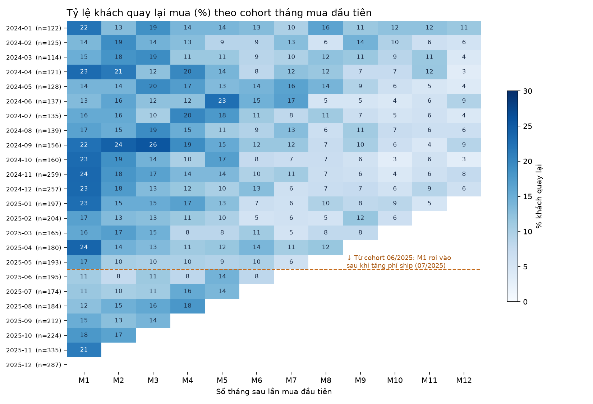
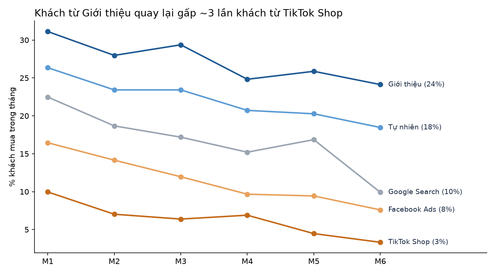
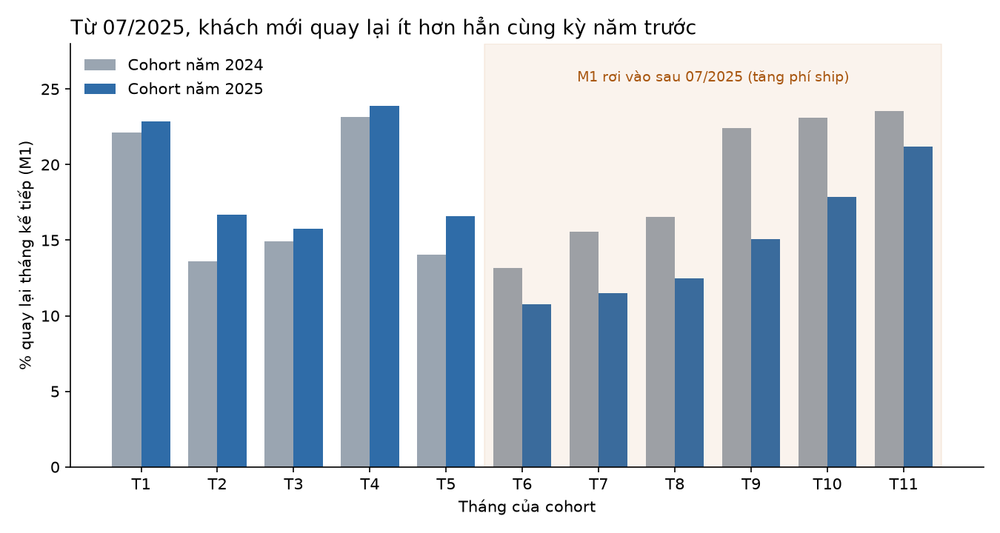
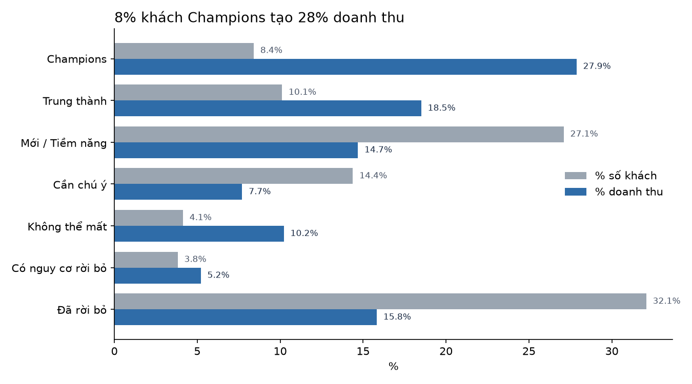

# Phân tích khách hàng thương mại điện tử: Cohort & RFM

**SQL (MySQL 8) · Python (pandas, matplotlib) · Cohort retention · Phân nhóm RFM · Phân tích theo kênh thu hút**

Phân tích hành vi mua lại của khách hàng cho một cửa hàng mỹ phẩm và thời trang online tại Việt Nam (01/2024 – 12/2025). Dự án trả lời: *khách có quay lại không, kênh nào mang về khách tốt, điều gì làm khách bỏ đi, và nên chăm sóc nhóm khách nào trước?*

> **Lưu ý:** đây là **dữ liệu giả lập** do tác giả tạo bằng `scripts/generate_data.py`, có cài sẵn một số kịch bản kinh doanh để phân tích. Mục tiêu của dự án là thể hiện **quy trình phân tích**; các con số không phản ánh doanh nghiệp thật.

### Kết quả nổi bật

- **Chỉ 18% khách quay lại ngay tháng sau**, 10% còn mua ở tháng thứ 6. 45,5% khách mua từ 2 đơn, nhưng nhóm này tạo **79% doanh thu**.
- **Kênh thu hút quyết định chất lượng khách:** 77% khách từ *Giới thiệu* mua lại trong 6 tháng, so với **29%** khách từ *TikTok Shop*. Doanh thu 6 tháng đầu mỗi khách chênh **2,4 lần**.
- **Voucher đơn đầu thu hút khách "săn sale":** khách dùng voucher ở đơn đầu mua lại trong 6 tháng **36%**, so với 59% khách không dùng.
- **Từ 07/2025 (tăng phí vận chuyển), khách mới quay lại ít hơn:** tỷ lệ quay lại M1 giảm từ 19,8% xuống **15,6%** so với cùng kỳ, trong khi trước đó đang tăng.
- **RFM:** 8% khách *Champions* tạo 28% doanh thu. 182 khách *Không thể mất* (từng mua nhiều, đã hơn 1 năm vắng mặt) giữ 10% doanh thu lịch sử, là nhóm cần liên hệ trước.

---

## 1. Dữ liệu

| File | Số dòng | Một dòng là |
|---|---:|---|
| `data/customers.csv` | 4.685 | một khách: ngày đăng ký, thành phố, nhóm tuổi, **kênh thu hút** |
| `data/orders.csv` | 11.097 | một đơn: ngày, trạng thái, số món, giá trị trước/sau giảm giá, có dùng voucher, phương thức thanh toán |

Kênh thu hút: Facebook Ads, TikTok Shop, Google Search, Giới thiệu, Tự nhiên. Giá trị đơn tính bằng VND.

Dữ liệu có cài sẵn lỗi để làm sạch: đơn ghi trùng, đơn test giá trị 0, đơn hủy và hoàn trả.

## 2. Cấu trúc repo

```
customer-rfm-cohort/
├── README.md
├── data/                          customers.csv, orders.csv (dữ liệu giả lập)
├── scripts/generate_data.py       code sinh dữ liệu (seed cố định, chạy lại ra y hệt)
├── sql/
│   ├── 01_load_data.sql           nạp CSV vào MySQL
│   ├── 02_clean.sql               kiểm tra, gắn nhãn từng đơn, tạo orders_clean
│   ├── 03_cohort.sql              ma trận cohort, giữ chân theo kênh, voucher, so sánh cùng kỳ
│   ├── 04_rfm.sql                 chấm điểm RFM, phân nhóm, danh sách ưu tiên
│   ├── 05_key_metrics.sql         bảng số liệu chính
│   └── run_all.sql                chạy bước 2 → 5 một lần
├── notebooks/rfm_cohort_charts.ipynb   tính lại bằng pandas để đối chiếu + vẽ biểu đồ
└── images/                        4 biểu đồ
```

## 3. Làm sạch

Mỗi đơn được gắn nhãn "Giữ lại" hoặc lý do loại (bảng `order_audit`), để đo được ảnh hưởng của từng quy tắc và chứng minh không mất dòng nào.

| Lý do | Số đơn |
|---|---:|
| Đơn test / giá trị 0 | 25 |
| Dòng trùng mã đơn | 70 |
| Đơn hủy / hoàn trả | 1.099 |
| **Giữ lại** (đơn hoàn thành, `orders_clean`) | **9.903** |

Sau làm sạch: **4.403 khách** có ít nhất 1 đơn hoàn thành, doanh thu thuần **4,64 tỷ VND**, giá trị đơn trung bình **468 nghìn VND**.

**Kiểm chứng:** tổng các nhóm bằng số dòng thô (11.097); bảng sạch không còn trùng; tổng tiền trong bảng RFM khớp tổng tiền đơn sạch. Notebook tính lại bằng pandas và ra cùng kết quả với SQL.

## 4. Cohort: khách có quay lại không?

**Cohort** = nhóm khách có đơn hoàn thành đầu tiên trong cùng một tháng. **M1, M2…** = tháng thứ 1, 2… sau tháng đầu tiên.



| Tháng sau lần mua đầu | M1 | M2 | M3 | M6 | M9 | M12 |
|---|---:|---:|---:|---:|---:|---:|
| % khách còn mua (trung bình có trọng số) | 18,2% | 15,4% | 14,7% | 10,1% | 8,7% | 6,4% |

Khách rơi nhanh nhất ở **tháng đầu tiên**: hơn 80% không quay lại ngay tháng sau. Sau đó tỷ lệ giảm chậm dần.

### Theo kênh thu hút



Tính trên cohort 01/2024 – 06/2025, để mọi khách đều có đủ 6 tháng theo dõi:

| Kênh | Số khách | Mua lại trong 3 tháng | Mua lại trong 6 tháng | Doanh thu 6 tháng đầu / khách |
|---|---:|---:|---:|---:|
| Giới thiệu | 286 | 60,5% | **76,9%** | ~1,43 triệu VND |
| Tự nhiên | 444 | 52,5% | 66,4% | ~1,30 triệu VND |
| Google Search | 605 | 43,1% | 57,4% | ~1,09 triệu VND |
| Facebook Ads | 869 | 35,3% | 47,2% | ~0,84 triệu VND |
| TikTok Shop | 783 | 20,7% | **28,7%** | ~0,59 triệu VND |

### Voucher ở đơn đầu tiên

| Đơn đầu tiên | Số khách | Mua lại trong 6 tháng |
|---|---:|---:|
| Không dùng voucher | 1.813 | **59,1%** |
| Có dùng voucher | 1.174 | **36,2%** |

### Điều gì thay đổi từ 07/2025?

So sánh tỷ lệ quay lại M1 của **cùng tháng cohort** giữa 2024 và 2025 (so cùng tháng để loại bỏ ảnh hưởng mùa vụ):



| Nhóm cohort | M1 năm 2024 | M1 năm 2025 | Thay đổi |
|---|---:|---:|---:|
| Tháng 1–5 (M1 rơi vào trước 07/2025) | 17,5% | 19,2% | +1,7 điểm % |
| Tháng 6–11 (M1 rơi vào từ 07/2025) | 19,8% | 15,6% | **−4,2 điểm %** |

Trước 07/2025 khách mới quay lại **tốt hơn** năm trước. Từ 07/2025, đúng lúc tăng phí vận chuyển, tỷ lệ này **giảm rõ** ở mọi tháng. Cách so sánh này (chênh lệch trước/sau, đối chiếu với cùng kỳ) giúp tách ảnh hưởng của sự kiện khỏi mùa vụ.

## 5. RFM: chia khách thành nhóm

- **R (Recency):** số ngày từ đơn gần nhất đến 01/01/2026. Điểm 1–5 bằng `NTILE(5)` (R5: mua trong khoảng 44 ngày gần đây; R1: từ khoảng 413 ngày trở lên).
- **F (Frequency):** số đơn hoàn thành. Điểm theo ngưỡng cố định (1, 2, 3, 4–5, 6+ đơn), vì phần lớn khách chỉ có 1–2 đơn, chia đều theo `NTILE` sẽ xếp ngẫu nhiên các khách giống hệt nhau vào các điểm khác nhau.
- **M (Monetary):** tổng tiền thực trả. Điểm 1–5 bằng `NTILE(5)`.



| Nhóm | Cách nhận biết | Số khách | % khách | % doanh thu | Recency TB (ngày) | Số đơn TB | Hành động |
|---|---|---:|---:|---:|---:|---:|---|
| Champions | R 4–5, F 4–5 | 370 | 8,4% | **27,9%** | 45 | 7,1 | Ưu đãi riêng, mời giới thiệu bạn bè |
| Trung thành | R 4–5 & F 3, hoặc R 3 & F 3–5 | 445 | 10,1% | 18,5% | 131 | 3,9 | Tích điểm, gợi ý mua kèm |
| Mới / Tiềm năng | R 4–5, F 1–2 | 1.193 | 27,1% | 14,7% | 52 | 1,3 | Kích hoạt đơn thứ 2 trong 30 ngày |
| Cần chú ý | R 3, F 1–2 | 633 | 14,4% | 7,7% | 196 | 1,3 | Nhắc nhở kèm ưu đãi có thời hạn |
| **Không thể mất** | R 1–2, F 4–5 | 182 | 4,1% | **10,2%** | 372 | 5,3 | **Liên hệ cá nhân, hỏi lý do, ưu đãi quay lại** |
| Có nguy cơ rời bỏ | R 1–2, F 3 | 168 | 3,8% | 5,2% | 392 | 3,0 | Email cá nhân hóa |
| Đã rời bỏ | R 1–2, F 1–2 | 1.412 | 32,1% | 15,8% | 457 | 1,2 | Chiến dịch chi phí thấp, không đầu tư nhiều |

**RFM theo kênh:**

| Kênh | % Champions + Trung thành | % Đã rời bỏ |
|---|---:|---:|
| Giới thiệu | 41,3% | 10,8% |
| Tự nhiên | 30,9% | 22,5% |
| Google Search | 22,0% | 27,4% |
| Facebook Ads | 12,5% | 34,5% |
| TikTok Shop | 6,9% | 46,6% |

Champions và Trung thành chỉ chiếm **18,5% số khách** nhưng tạo **46,4% doanh thu**. Danh sách từng khách có trong kết quả mục 4.6 của `sql/04_rfm.sql`.

## 6. Đề xuất

1. **Xem lại chính sách phí vận chuyển:** tỷ lệ quay lại tháng đầu giảm 4,2 điểm % so với cùng kỳ ngay sau khi tăng phí. Thử miễn phí ship cho **đơn thứ 2** hoặc hạ ngưỡng miễn phí ship. *Theo dõi: tỷ lệ M1 hằng tháng.*
2. **Phân bổ lại ngân sách thu hút khách:** đẩy mạnh chương trình **giới thiệu bạn bè** và Google Search. Với TikTok Shop, cần so chi phí thu hút một khách (CAC) với doanh thu 6 tháng thấp hơn 2,4 lần. *Theo dõi: doanh thu 6 tháng / CAC theo kênh.*
3. **Thiết kế lại voucher đơn đầu:** giảm mức giảm giá đơn đầu, chuyển một phần sang voucher **cho đơn thứ 2**, để thưởng cho hành vi quay lại thay vì thu hút khách chỉ săn sale.
4. **Kéo lại 182 khách "Không thể mất":** liên hệ cá nhân trước mùa 11.11 – 12.12. *Theo dõi: % nhóm này mua lại trong 60 ngày.*
5. **Kích hoạt đơn thứ 2 cho 1.193 khách "Mới / Tiềm năng":** gửi nhắc kèm ưu đãi trong 30 ngày sau đơn đầu, vì đây là giai đoạn mất khách nhiều nhất.

## 7. Giới hạn

- Dữ liệu giả lập: các quan hệ (kênh, voucher, phí vận chuyển) được cài sẵn khi sinh dữ liệu. Với dữ liệu thật, cần thận trọng hơn khi suy ra nhân quả.
- Phân tích theo kênh và voucher là **quan sát**: khách từ các kênh khác nhau có thể khác nhau ở nhiều mặt khác. Muốn biết chắc tác động của voucher hay phí vận chuyển, nên làm A/B test.
- Không có dữ liệu chi phí marketing (CAC), nên chưa tính được lợi nhuận theo kênh.
- Cohort 2025 có ít tháng theo dõi hơn; các ô chưa đủ thời gian được để trống, không tính là 0.

## 8. Cách chạy lại

1. Nạp dữ liệu: mở cmd **tại thư mục `data`**, chạy
   ```
   mysql -u root -p --local-infile=1 --default-character-set=utf8mb4 --table < ../sql/01_load_data.sql
   ```
2. Chạy toàn bộ phân tích: mở cmd **tại thư mục gốc repo**, chạy
   ```
   mysql -u root -p --default-character-set=utf8mb4 --table < sql/run_all.sql > ket_qua.txt
   ```
   Hai dòng `ket_qua` trong file kết quả phải là `OK`.
3. Biểu đồ: `pip install pandas numpy matplotlib`, mở `notebooks/rfm_cohort_charts.ipynb` → **Restart → Run All**.
4. (Tùy chọn) Sinh lại dữ liệu: `python scripts/generate_data.py`.

---

**Tác giả:** Nguyễn Bá Hồng Minh
